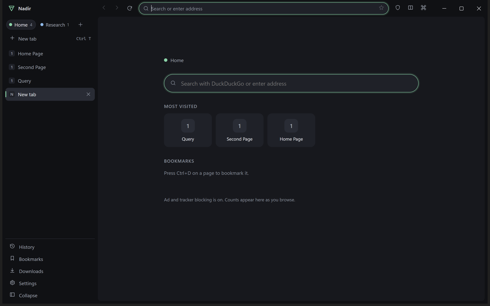

# Nadir

A privacy-first, workspace-centric desktop browser built on Chromium (via Electron). Open source, **GPL-3.0-or-later**.

> **Status: 0.1.0, a working foundation — not a Chrome replacement.** It browses, isolates workspaces, blocks trackers, restores sessions and has a command palette. It has **no extension support, no sync, no password manager, no AI features yet**, and has **not been security-audited or packaged/signed**. [FEATURE-MATRIX](docs/FEATURE-MATRIX.md) says exactly what is built and tested.



## What makes it different (what exists today)

- **Workspaces are real isolation.** Each workspace has its own cookies, cache, storage, history and permissions. Delete a workspace and its data goes with it. Private tabs use a memory-only partition.
- **Command palette (Ctrl+K)** over tabs, history, bookmarks, workspaces and commands. Address-bar suggestions are computed **locally**; keystrokes are never sent to a search provider.
- **Privacy defaults that are visible:** Ghostery filter engine (network + cosmetic), HTTPS-first with an explicit, no-bypass failure page, tracking-parameter stripping, Global Privacy Control, deny-by-default site permissions, a dashboard showing what was blocked and what the limits are.
- **Sleeping tabs and lazy restore:** inactive tabs unload; restarts load only the active tab per workspace.
- **Safe downloads:** sanitised file names, risk flags (including disguised `.pdf.exe`), executables are never launched by the browser.
- **Hardened architecture:** tab renderers have no IPC at all; the main process re-validates every sender; internal pages are CSP-locked ([SECURITY](docs/SECURITY.md)).

## Requirements

Windows 10/11 (tested on Windows 11). Node.js ≥ 22.12 (developed with 26) and npm. Linux/macOS are expected to work but are **untested**.

## Run

```bash
npm ci
npm start
```

Your data lives in Electron's user-data folder (shown in **Settings → About**). To use a throwaway profile: `NADIR_USER_DATA=/tmp/nadir-test npm start`.

## Test

```bash
npm test            # 57 unit tests (plain Node, <2 s)
npm run test:e2e    # 42 end-to-end tests: real app against a local server; only tls.test.js (5 tests) uses the internet (badssl.com) and skips when offline
npm run audit       # npm audit for production dependencies
node scripts/bench.js   # reproducible performance baseline vs. installed Chrome (see docs/PERFORMANCE.md)
```

The e2e suite drives the real application with `playwright-core`, injects keyboard input with `webContents.sendInputEvent` (never OS-level input) and writes only to temporary profiles.

## Package

```bash
npm run package     # unsigned folder build in out/ (see docs/ARCHITECTURE.md §7 for signing/updates)
node scripts/verify-package.js   # launches the packaged exe and checks it browses
```

## Repository layout

```
src/main      main process (controller, tabs, store, blocker, permissions, downloads, IPC)
src/shared    pure logic shared by everything (URLs, shortcuts, fuzzy match, filenames)
src/ui        nadir:// pages and the design system (tokens.css)
test/unit     test/e2e
scripts       benchmark, capture and inventory tools
docs          research ledger, ADR, architecture, security, design, roadmap, benchmarks
```

## Documentation

| | |
|---|---|
| [Research ledger](docs/research/LEDGER.md) | 40+ projects checked against primary sources on 2026-10-11, with confidence levels and scores |
| [**HANDOFF**](HANDOFF.md) | start here if you are picking the project up: status, how to run and verify, traps, and the full to-do list |
| [Release notes and signing](docs/RELEASE.md) | what is tested for packaging and signing, and what still needs a certificate, a public repository and an installer |
| [Project catalog](docs/research/CATALOG.md) | 772 open-source browser-related projects verified against the GitHub API and classified (Core / High-value / Optional / Experimental / Reference / Rejected / Out-of-scope) |
| [Discovery sweep](docs/research/SWEEP.md) | how the catalog was built, and an explicit list of what it does **not** cover — "every possible project" is not achievable |
| [ADR-0001](docs/adr/0001-architecture.md) | why Electron/Chromium, what was rejected, revisit triggers |
| [Architecture](docs/ARCHITECTURE.md) | diagrams, process model, data flows, interface contracts, build/update plan |
| [Security & privacy](docs/SECURITY.md) | threat model, tests per threat, **known gaps** |
| [Design system](docs/DESIGN.md) | name, mark, tokens, interaction principles, accessibility status |
| [Signature features](docs/SIGNATURE-FEATURES.md) | what is built vs. planned, with costs and risks |
| [Feature matrix](docs/FEATURE-MATRIX.md) | built / tested / partial / planned / blocked |
| [Performance](docs/PERFORMANCE.md) | targets (proposed), method, **measured** results, caveats |
| [Licenses](docs/LICENSES.md) | dependency licence inventory and distribution notes |
| [Decision log](docs/DECISIONS.md) · [Roadmap](docs/ROADMAP.md) | |

## Known limitations (short list)

Electron's Chromium trails upstream by a few majors (keep Nadir updated) · no Chrome-extension support · no sync/passwords/AI yet · unsigned, no auto-update · single window · Windows only verified · accessibility not audited · "Nadir" is not trademark-cleared.

## License

GPL-3.0-or-later. Bundled third-party components keep their own licences; see [docs/LICENSES.md](docs/LICENSES.md).
