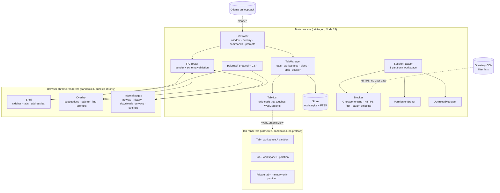
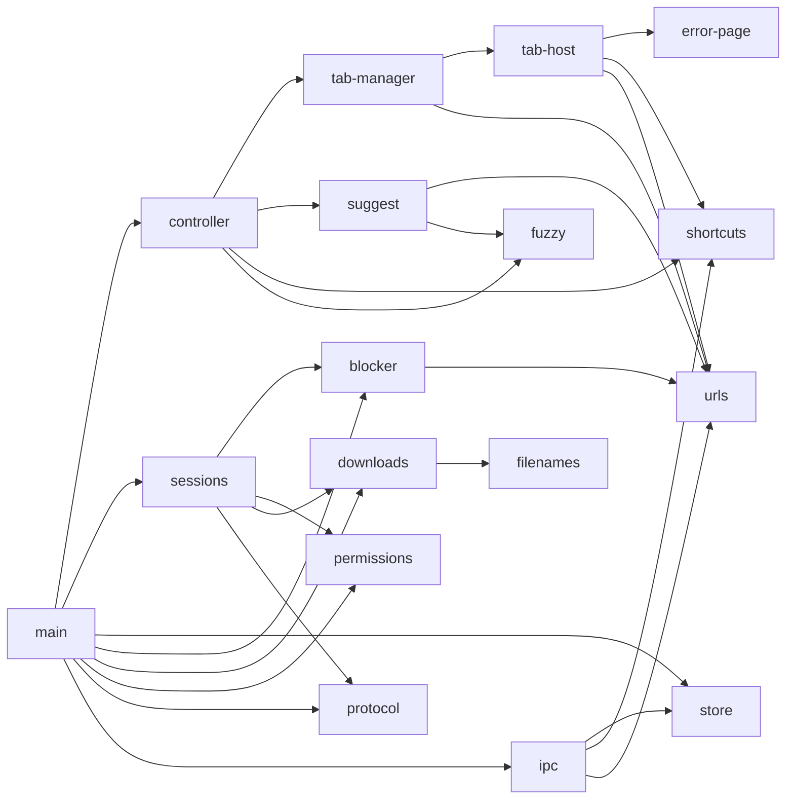

# Pelorus — Architecture

Decision rationale: [ADR-0001](adr/0001-architecture.md). Evidence: [research ledger](research/LEDGER.md).
Everything below describes **what is built today** unless marked *(planned)*.

## 1. System architecture



## 2. Component dependency graph


No cycles. `src/shared/*` is pure (no Electron imports) and unit-tested in plain Node.

## 3. Process and security boundaries

| Surface | Trust | Loads | Sandbox | Node | Preload | Can call IPC |
|---|---|---|---|---|---|---|
| Main | full | — | n/a | yes | — | — |
| Shell (toolbar/sidebar) | trusted UI | `pelorus://shell` | yes | no | `preload-chrome.js` (allowlist) | shell + shared channels only |
| Overlay | trusted UI | `pelorus://overlay` | yes | no | `preload-chrome.js` | overlay + shared channels only |
| Internal pages | trusted UI | `pelorus://newtab`, `pelorus://app` | yes | no | `preload-internal.js` (self-checks `location.protocol`) | internal channels only |
| **Web tabs** | **untrusted** | any http(s)/file | yes | no | **none** | **none** |
| Popups from tabs | untrusted | http(s) | yes | no | none | none |

Enforcement is layered: (1) preload allowlist, (2) the main process re-checks `event.sender` **and** `event.senderFrame === mainFrame` for every channel — proven by an e2e test that calls every privileged channel from a window with raw `ipcRenderer`, (3) per-setting validators, (4) CSP on all `pelorus://` content (no inline script, no `connect-src`).

Internal ↔ web navigation **swaps the renderer** (`TabManager.navigate`) so web content can never inherit an internal page's preload.

## 4. Data flows

**Navigation** — Shell input → `tab:navigate` → `resolveInput` (rejects `javascript:`/`data:`/unknown schemes) → `TabManager.navigate` → `TabHost.loadURL` → `session.webRequest.onBeforeRequest` (strip tracking params → HTTPS-first upgrade → blocker) → network → `did-navigate` → history row (not for private tabs / internal pages) → snapshot → Shell.

**Permission** — page API → `setPermissionRequestHandler` → `policyFor()` (deny-by-default; subframes never prompt) → stored decision for *(workspace, origin, permission)* or overlay prompt (focus on **Block**) → persisted only if "remember" and not private.

**Download** — `will-download` → sanitise name (strip path, bidi, reserved names) → unique path in Downloads → risk class by extension (+ disguised double-extension) → DB row → progress to internal pages. Executable/script/shortcut/disk-image types are never launched by Pelorus, only revealed in the folder.

**Session** — every state change → debounced `serialize()` → `kv` table. Restore recreates tabs **asleep**; only the active tab per workspace loads.

## 5. Repository structure

```
src/main/        main process: main, controller, tab-manager, tab-host, store, blocker,
                 permissions, downloads, sessions, protocol, ipc, suggest, error-page
src/shared/      pure logic (no Electron): urls, shortcuts, fuzzy, filenames
src/ui/          shell/ overlay/ newtab/ app/ (HTML)  ·  assets/ (CSS, JS, icons, preloads)
test/unit/       node:test, runs in plain Node
test/e2e/        node:test + playwright-core driving the real app against a local server
scripts/         bench.js, proctree.ps1, capture-window.ps1, smoke.js, live-demo.js, license-inventory.js
docs/            research/, adr/, benchmarks/, and the documents in this folder
```

## 6. Interface contracts

`TabHost` (engine boundary; replace to change engine)
```
new TabHost({kind:'web'|'internal', session, preload?})
loadURL(url) reload(hard) stop() back() forward() setBounds(r) setVisible(b) focus()
zoom(delta) find(text,{forward,findNext}) stopFind() devtools() showError({url,code,desc,httpFallback?}) destroy()
events: loading · nav-start · navigated{url,inPage} · title · favicon · audio · crashed · fail{url,code,desc}
        open-url{url,background,replace?} · command · found · zoom · fullscreen · allow-http
```
`Store` — synchronous, parameterised SQL only: `settings() setSetting(k,v)` (allowlisted keys) · `addVisit updateTitle searchHistory(q,{workspaceId,limit}) clearHistory{,Since}` · `bookmarks…` · `downloads…` · `getPermission/setPermission` · `workspaces…` · `getState/setState`.

`Blocker` — `init({refresh})`, `attach(session)`, `refresh()`, `status()`, `allowHttp(host)`, `takeUpgradeOrigin(httpsUrl)`.

`PermissionBroker` — `install(session)`; pure `policyFor(permission,{isMainFrame}) → allow|prompt|deny`.

IPC channel catalogue: see `src/ui/assets/preload-chrome.js` and `preload-internal.js` (allowlists) and `src/main/ipc.js` (scope + validation).

## 7. Build, packaging, update, distribution

| Concern | Today | Planned |
|---|---|---|
| Build | none needed (plain JS, no bundler) — `npm ci && npm start` | esbuild bundle of `src/main` for startup time |
| Package | `npm run package` (`@electron/packager`, unsigned folder build) | `electron-builder` NSIS/MSI, AppImage/deb, dmg |
| Signing | none (**blocked**: needs a code-signing certificate) | Authenticode / Apple notarisation |
| Update | none | `electron-updater` against signed releases; must track Electron stable majors (~8-week cadence) — this is the main security-maintenance obligation |
| Reproducibility | `package-lock.json`, exact dependency pins | build in CI container, publish SBOM |
| Vulnerability monitoring | `npm audit` (0 findings at time of writing) | Dependabot/Renovate + Electron release watch |
